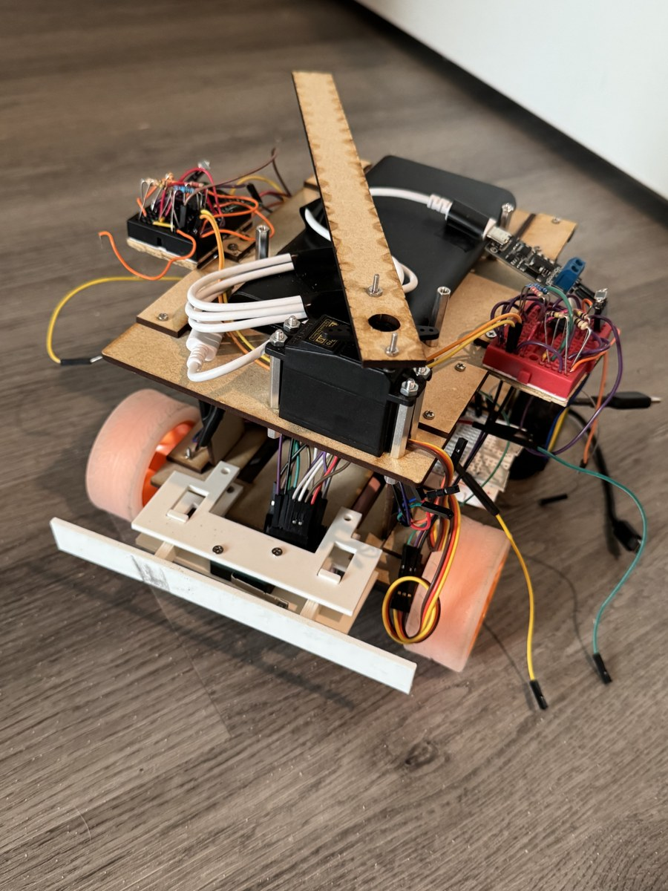
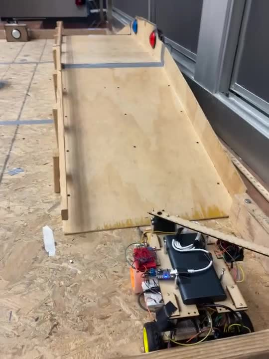
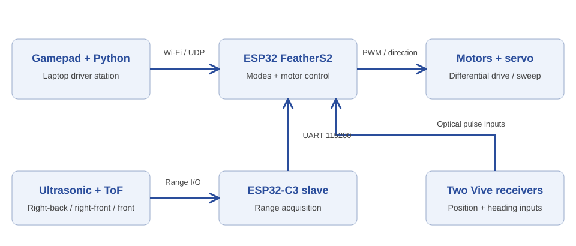

# ROBA: ESP32 Mobile Robot and Driver Station

A four-wheel competition robot integrating an Xbox/Python driver station, an ESP32 master and sensor slave, range-feedback wall following, Vive target navigation, and a servo mechanism. Operator commands and onboard sensing feed a common motor-control system; fixed-time attack routines are kept distinct from feedback navigation.



[](https://yixiaoliu.me/projects/roba-mobile-robot/#demonstrations)

*Real hardware footage: traversal alongside the arena boundary followed by a turn. Open the project page for three controlled-playback clips. Recorded during the team project.*

[Project page and videos](https://yixiaoliu.me/projects/roba-mobile-robot/) · [Final report](MEAM_5100_final_report.pdf) · [Operating guide](docs/OPERATING_GUIDE.md)

## Capabilities

- **Manual drive:** Pygame reads gamepad axes/buttons, selects a discrete direction and sends newline-terminated UDP commands.
- **Embedded sensing:** the ESP32-C3 samples two right-side ultrasonic sensors and a front VL53L0X ToF sensor, filters invalid/noisy readings and streams distances over UART.
- **Wall following:** the master uses distance and angle corrections from the right sensors, plus a front-distance turn override.
- **Vive target navigation:** two optical receivers estimate center/heading; a filtered rotate/drive state machine handles a single target or a two-target queue.
- **Mechanism and tasks:** joystick-selectable servo sweeping and three predefined motor sequences for low-tower, high-tower and nexus tasks.

## System architecture



The master owns mode selection and actuation. The sensor slave keeps blocking range acquisition separate from Wi-Fi and motion control. Optional TopHat I²C sends packet counts; it is not the slave's distance channel.

## Hardware and operating modes

Laser-cut MDF plates and cross-bracing form the two-level chassis, with a compliant 3D-printed bumper, four DC geared drive motors and two H-bridge drivers. The upper structure holds the servo mechanism and keeps the two Vive receivers visible. The report discusses noisy ranges, Vive jitter and sensitivity to the power configuration.

| Mode | Input and feedback | Output |
|---|---|---|
| Joystick | Axes 0/1, 0.25 deadzone; A/B choose mode, LB toggles servo | F/B/L/R/S motor commands, continuous servo sweep |
| Wall follow | RB arms; UART `DIST:RB,RF,F` in cm | Distance/angle correction, front-triggered left turn |
| Vive | Terminal coordinates; two-receiver pose | Rotate to heading, drive toward target, stop/load next target |
| AL / AH / AN | Explicit task command while in Vive mode | Fixed-duration drive/turn/contact sequence; not feedback path planning |

UDP uses robot `192.168.4.1:4210` and laptop receive port 5005. UART is 115200 baud, 8N1. Full pin assignments, message formats, thresholds, mode transitions and stop behavior are in the [operating guide](docs/OPERATING_GUIDE.md).

## Setup and quick start

Use Python 3.12 and a compatible gamepad:

```powershell
python -m venv .venv
.\.venv\Scripts\python.exe -m pip install -r requirements.txt
.\.venv\Scripts\python.exe -m unittest discover -s tests -v
# After flashing the correct boards and joining the robot's Xbox_Joy Wi-Fi AP:
.\.venv\Scripts\python.exe Controller_Python.py
```

Firmware uses Arduino-ESP32, Adafruit VL53L0X, and the original Penn Vive interface located in the supplied archive. [Firmware staging, compilation and upload commands](docs/OPERATING_GUIDE.md#install-and-build) keep original sketches intact and the separately supplied Vive source local. [Executed software/compilation checks](docs/VERIFICATION.md) distinguish build validation from hardware operation.

## Demonstrations and engineering observations

The [project page](https://yixiaoliu.me/projects/roba-mobile-robot/) includes full-length, same-speed clips of wall-side traversal, an arena maneuver and a target-contact sequence, plus mechanism and electronics photos. Our team placed third in the Penn MEAM 5100 robotics competition, competing in the alliance format described in the [report](MEAM_5100_final_report.pdf).

Report-linked historical recordings: [competition nexus routine](https://www.youtube.com/watch?v=f1X58f-0aBQ) and [high-tower test](https://www.youtube.com/shorts/K8pAkWYsFU8). The report provides context for the competition routines.

Vive noise motivated using timed sequences for capture tasks. The committed attack functions use blocking `delay()` calls despite the report's nonblocking description. There is no enforced UDP-loss watchdog; S does not cancel active navigation. Those preserved limitations, supply/logic-level requirements and reproduction conditions are detailed in the operating guide.

Developed as a Penn MEAM 5100 team project.
